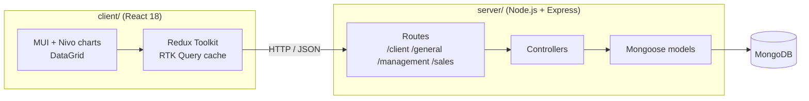

<div align="center">
  
  <h1>Tenfax Sales Dashboard</h1>
  <p>A full-stack MERN admin dashboard that turns raw sales, product and customer data into interactive analytics.</p>
</div>

## Overview

Tenfax is a React single-page app backed by an Express/Node.js REST API and MongoDB. It answers the questions a sales or operations lead asks every week: how are sales trending, which products and categories drive revenue, where are customers located, and how are individual reps performing.

**Highlights**

- **11 analytics views:** dashboard KPIs, products, customers, transactions, geography, sales overview, daily and monthly trends, category breakdown, admins and rep performance
- **Server-side pagination, sorting and search** on transactions, so the browser only ever loads one page of rows
- **MongoDB aggregation** (`$lookup` + `$unwind`) to join reps with their affiliate sales for the performance view
- **Choropleth map** of customers by country (ISO-2 → ISO-3 mapping on the server)
- **Light/dark theme** with a custom MUI design-token palette
- **RTK Query** for data fetching and caching, with one endpoint definition per API route

## Architecture



| Layer | Tech |
| --- | --- |
| Front end | React 18, React Router 6, Material UI 5, MUI X DataGrid, Nivo (line, bar, pie, geo) |
| State and data | Redux Toolkit, RTK Query |
| API | Node.js, Express 4, Helmet, CORS, Morgan |
| Database | MongoDB with Mongoose 6 |

## API

| Method | Route | Returns |
| --- | --- | --- |
| GET | `/general/dashboard` | KPIs, monthly series, category split, latest 50 transactions |
| GET | `/general/user/:id` | A single user (password excluded) |
| GET | `/client/products` | Products joined with their yearly stats |
| GET | `/client/customers` | Customers (password excluded) |
| GET | `/client/transactions?page=0&pageSize=20&sort={"field":"cost","sort":"desc"}&search=` | One page of transactions plus a total count |
| GET | `/client/geography` | Customer counts by ISO-3 country code |
| GET | `/sales/sales` | Yearly, monthly, daily and per-category sales |
| GET | `/management/admins` | Admin users |
| GET | `/management/performance/:id` | A rep and the transactions attributed to them |
| GET | `/health` | Liveness check |

## Getting started

**Prerequisites:** Node.js 18+ and a MongoDB connection string (a free MongoDB Atlas cluster works).

```sh
git clone https://github.com/CarltonOsinde/Tenfax-Dashboard.git
cd Tenfax-Dashboard

# 1. API
cd server
cp .env.example .env        # add your MONGO_URL
npm install
npm run seed                # loads the mock dataset (run once)
npm run dev                 # http://localhost:9000

# 2. Client (new terminal)
cd ../client
cp .env.example .env        # REACT_APP_BASE_URL=http://localhost:9000
npm install
npm start                   # http://localhost:3000
```

## Project structure

```
client/
  src/
    components/   reusable UI: charts, stat boxes, navbar, sidebar
    scenes/       one folder per page (dashboard, products, geography, ...)
    state/        Redux slice + RTK Query API definitions
    theme.js      light/dark design tokens
server/
  controllers/    request handlers and query logic
  routes/         Express routers
  models/         Mongoose schemas
  data/           mock dataset used by `npm run seed`
  seed.js         database seeding script
```

## Notes

- All data is **synthetic mock data**. The names, emails and passwords in `server/data` are generated placeholders, not real accounts.
- The dashboard reports as of 15 November 2021 to match the mock dataset. The constants are at the top of `server/controllers/general.js`.

## Contact

Carlton Osinde Makini · [LinkedIn](https://www.linkedin.com/in/carltonosinde/) · [carltonosinde.com](https://carltonosinde.com) · [Email](mailto:carltonosinde@gmail.com)
